# uru-mon

**A creature-collecting adventure across Bengaluru**, in the style of the classic handheld RPGs. It runs in the
browser on desktop and on phones, with nothing to install.

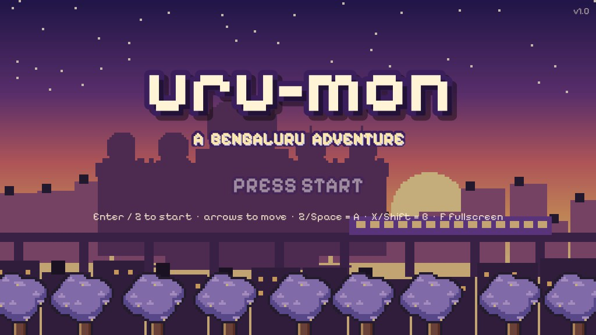

Catch Urumon in steel tiffin **Dabbas**, heal your team with idli at the neighbourhood **Darshini**, ride Namma Metro
between stations, and battle six Arena Leaders from Lalbagh's Glass House to the top of Nandi Hills. Along the way,
stop the **Concrete Syndicate** from paving over the city's lakes and parks, beat your rival Sudeep, and take on the
**Namma Council** at Vidhana Soudha.

*Uru* (ಊರು) is Kannada for *hometown*.

## Screenshots

| | |
|---|---|
| 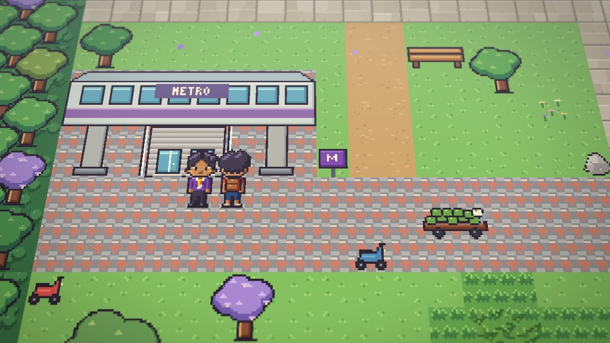 | 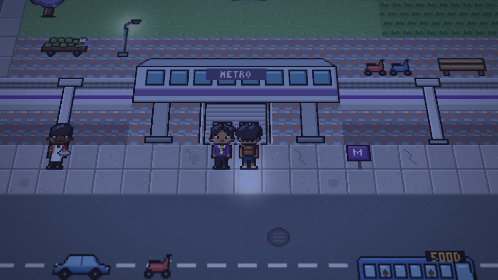 |
| Lalbagh by day, in the tilted HD-2D camera | MG Road at night: street lamps and lit windows |
| 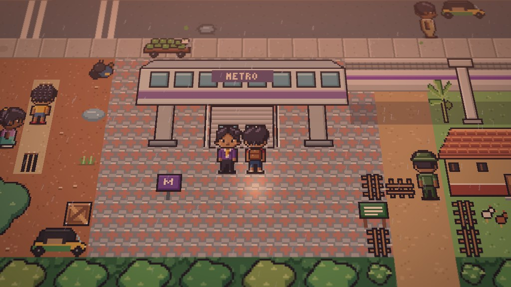 | 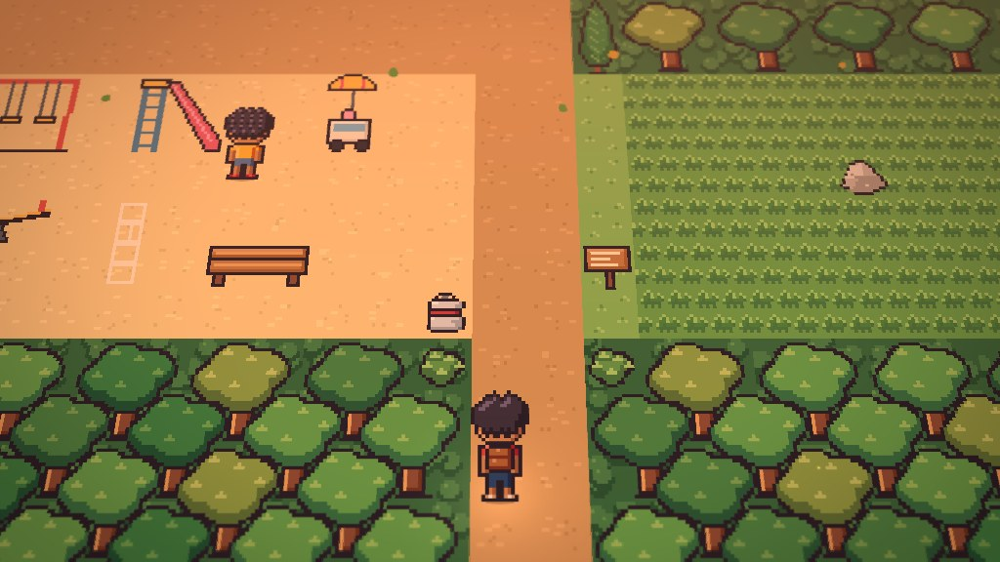 |
| A monsoon evening in Basavanagudi | Cubbon Park at dusk |
| 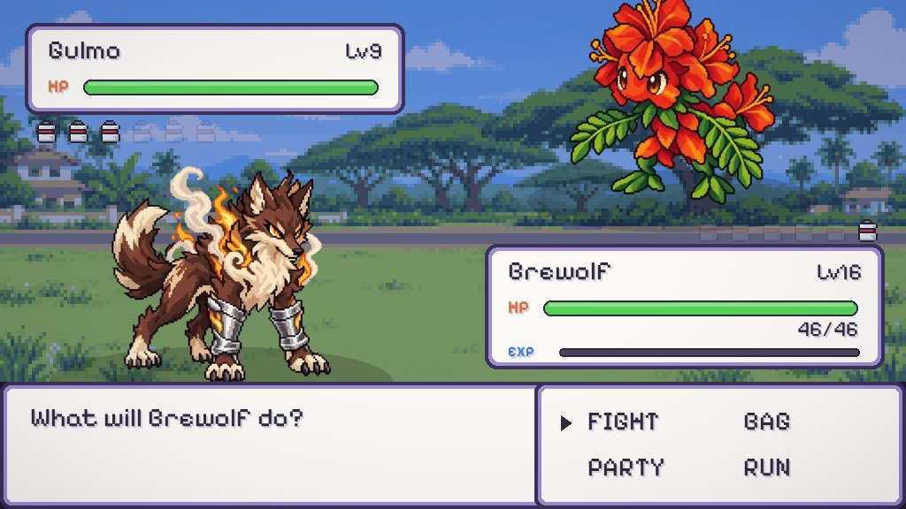 | 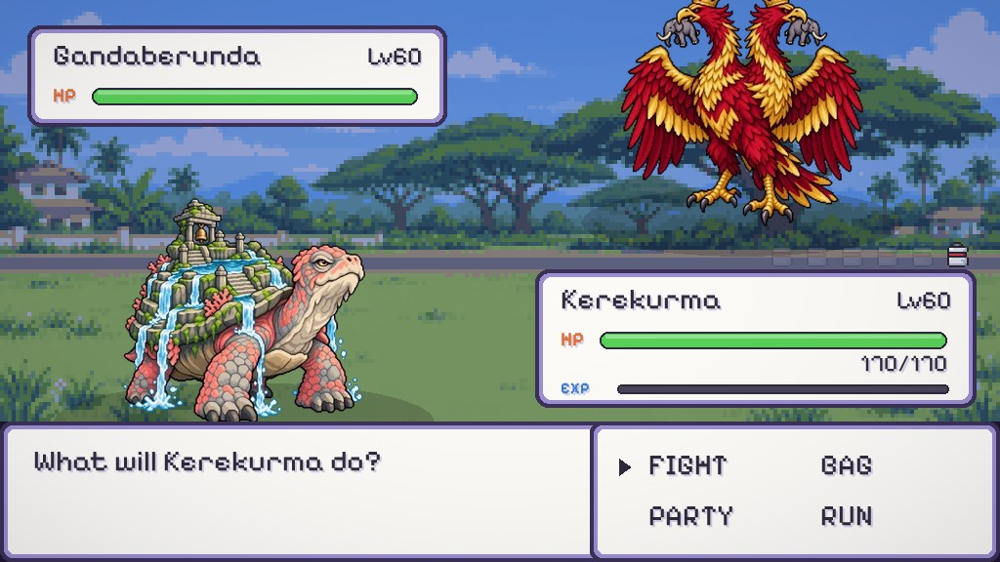 |
| Arena Leader Hoovamma | Gandaberunda, one of the legendaries |
| 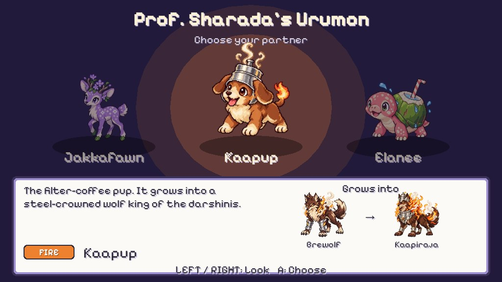 | 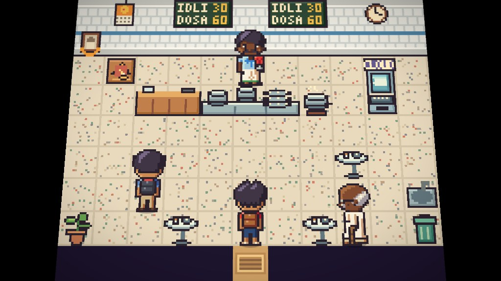 |
| Prof. Sharada's three starters | Inside the Darshini, where your team rests up |
| 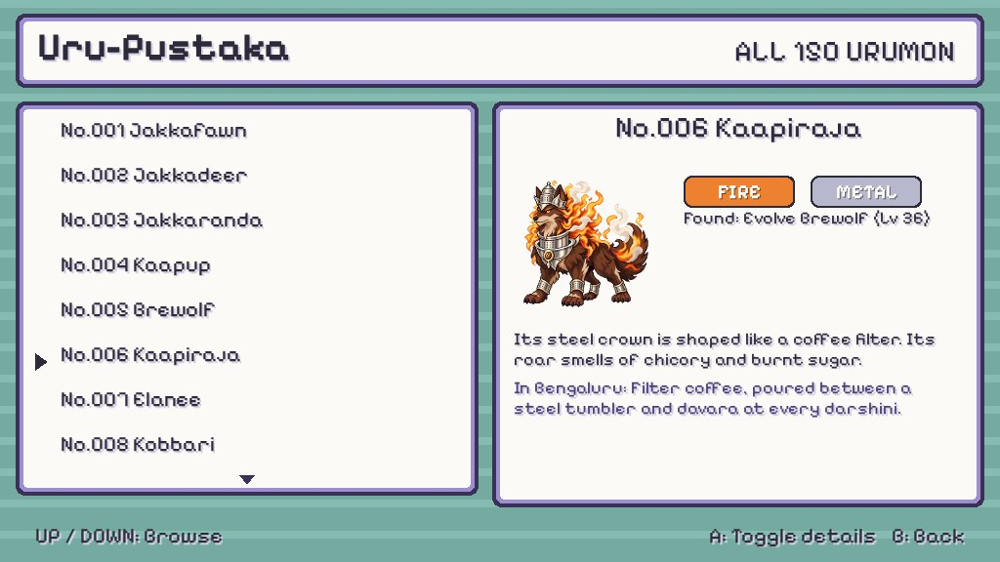 | 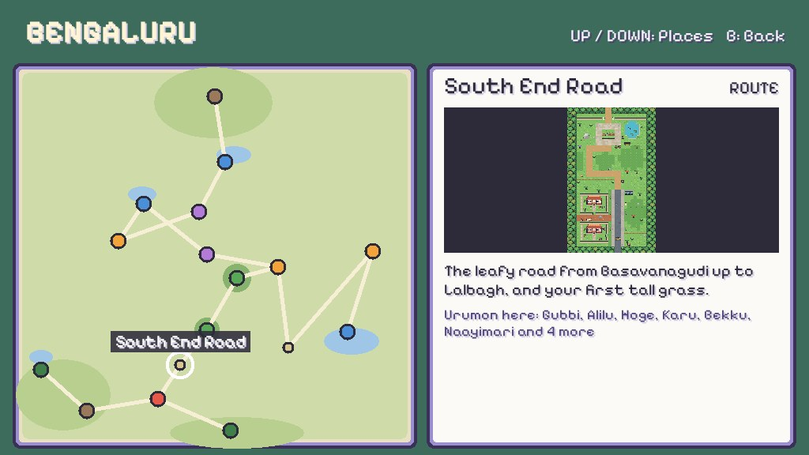 |
| The Uru-Pustaka: every Urumon, with where to find it | The Bengaluru map: every place and what lives there |
| 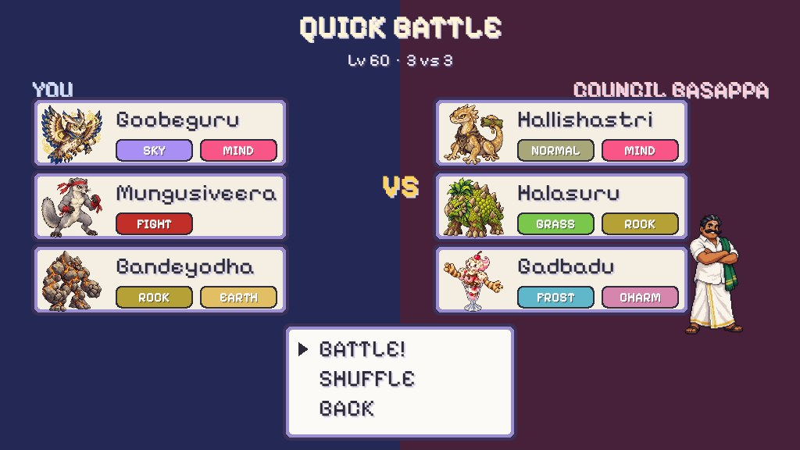 | 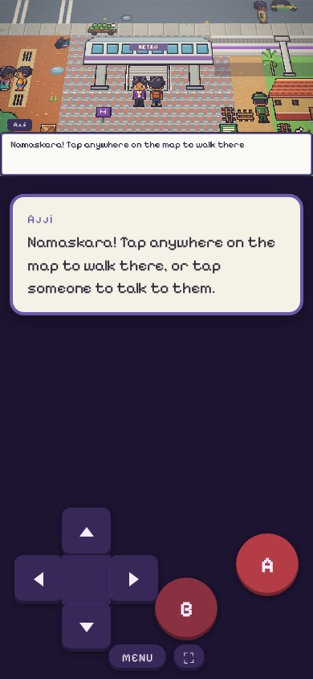 |
| Quick Battle: three random Lv 60 Urumon a side | On a phone: tap to walk, large dialogue text |

## Features

**The city**
- 36 maps of Bengaluru, including Basavanagudi, Lalbagh, Cubbon Park, MG Road, Chinnaswamy Stadium, Silk Board,
  Whitefield, Bellandur Lake, Sankey Tank, Malleshwaram, Palace Road, Hebbal, Nandi Hills and Vidhana Soudha, plus
  Bannerghatta, Ramanagara and Kokkare Bellur after the story.
- Namma Metro fast travel, darshinis to heal, kirana stores whose stock grows as you earn badges, and NPCs with
  something local to say.
- A full story: rival battles with Sudeep, the Concrete Syndicate, six Arena Leaders, the four-member Namma Council
  and the Champion.

**Urumon and battles**
- 150 original Urumon across 18 types, including four new ones: FROST, MYTH, ROGUE and CHARM.
- 151 moves, status effects (including freezing), evolution, fossils to revive, fishing with the Gaala rod, and six
  legendaries to find.
- 68 trainers with smart opponents, a free switch whenever a trainer's Urumon faints (or turn it off in Options), and
  high-resolution battle art.
- **Quick Battle** from the title screen: three random fully evolved Urumon at Lv 60 against a random trainer, with
  no save needed.

**Looks and sound**
- Three graphics modes. **HD-2D** tilts the camera, adds depth of field and haze, and lights the city by the time on
  your clock (dawn, day, dusk and night), with monsoon rain and street lamps after dark. ENHANCED and CLASSIC are
  flatter and lighter.
- 20 original chiptune tracks and sound effects, all synthesised in code.

**Play anywhere**
- Keyboard on desktop. On phones the game is built for touch: tap the map to walk there, tap a person, sign or door to
  use it, and tap menus and battle moves directly.
- In landscape the game fills the screen; in portrait, dialogue is repeated in large text below the game.
- Add it to your home screen to play full-screen like an app.
- Saves live in your browser, with no account needed.

**Before you play**
- Browse every Urumon in the **Uru-Pustaka**, and every place on the **Bengaluru map**, straight from the title screen.

## Controls

| | Keyboard | Touch |
|---|---|---|
| Move | Arrow keys / WASD | Tap where you want to go, or use the D-pad |
| A (talk, confirm) | Z or Space | Tap the person or thing, or the A button |
| B (back, hold to run) | X or Shift | B |
| Menu | Enter | MENU |
| Fullscreen | F | ⛶ |

## Roadmap

uru-mon is a static site today: no accounts, no server. These are planned, roughly in this order:

- [ ] **Public launch** on its own domain, with an installable app that also works offline.
- [ ] **Save codes**: export your save as a code and import it on another device.
- [ ] **Accounts and cloud saves**: sign in and pick up on any device.
- [ ] **Leaderboards**: Quick Battle win streaks, fastest time to Champion, Uru-Pustaka completion.
- [ ] **Battle your friends** online: share a link, pick your teams, and battle turn by turn.
- [ ] **Trading** Urumon between players.
- [ ] **City events**: the Kadalekai Parishe groundnut fair in Basavanagudi, Karaga, Dasara, and the monsoon bringing
  out rare Urumon.
- [ ] **Kannada language option**.
- [ ] More after the Champion: rematches, harder trainers and a battle tower.

## Run it locally

There is no build step. Serve the folder over HTTP and open it:

```
python3 -m http.server 8080
# then visit http://localhost:8080
```

Handy dev URLs:
- `?scene=test&map=lalbagh` jumps straight into a map with a test team (see `src/scenes/test-scene.js`).
- `?time=night&weather=rain&gfx=HD-2D` previews lighting and weather.

## How it's made

| Part | Where | Notes |
|---|---|---|
| Engine | `src/` | Phaser 3.60 (vendored) with plain ES modules. Battle rules live in `src/battle/engine/` with no Phaser, and are unit-tested in Node. |
| Game data | `tools/content/*.py` → `assets/data/*.json` | `python3 tools/content/build_data.py` |
| Maps | `tools/maps/*.py` → `assets/maps/` | Maps are written in Python and compiled to PNG layers plus Tiled-format JSON: `python3 tools/maps/build_maps.py --preview` |
| World art | `tools/art/tiles.py`, `characters.py`, `icons.py` | 16 px pixel art drawn in code |
| Creature, trainer and backdrop art | `tools/art/gen_images.py` + `process_art.py` | AI-generated, then pixelised and palette-reduced, plus smooth HD versions for battles |
| Visual effects | `src/fx/` | Time of day, weather, lights, and a one-pass HD-2D shader |
| Music and SFX | `tools/audio/synth.py` | Original chiptune, synthesised in code |
| Tests | `tools/test/` | `node --test tools/test/engine.test.mjs`; browser tests use Playwright (`cd tools && npm install`, then `tools/test/run-all.sh`) |

`docs/DESIGN.md` has the full game design. `node tools/test/readme-shots.mjs` (from `tools/`) retakes these screenshots.

## Credits

- Built on the MIT-licensed [monster-tamer](https://github.com/devshareacademy/monster-tamer) Phaser tutorial by
  Dev Share Academy (see `LICENSE`).
- [Phaser](https://phaser.io) game framework (MIT).
- [Pixelify Sans](https://github.com/eifetx/Pixelify-Sans) font (SIL Open Font License 1.1, `assets/fonts/pixelify/OFL.txt`).
- All creatures, characters, places, music and story are original to uru-mon. uru-mon is a fan-made homage to the
  monster-collecting genre and is not affiliated with any game company.
